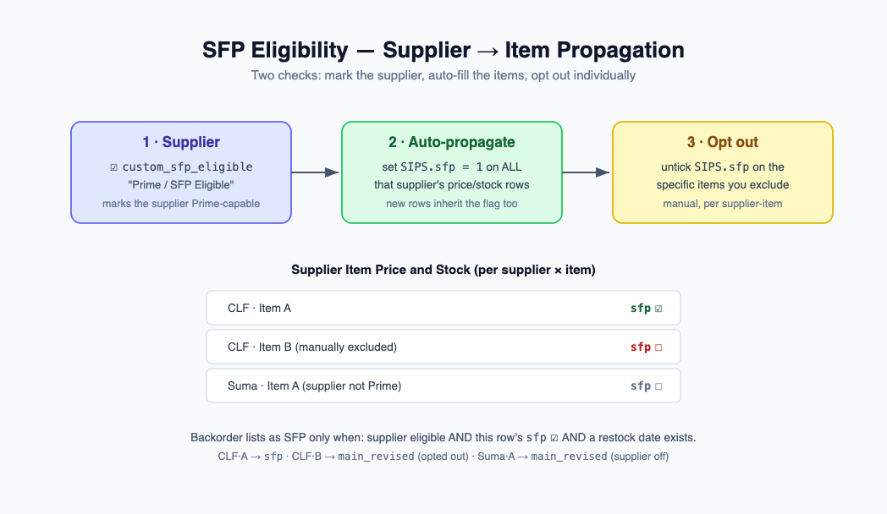
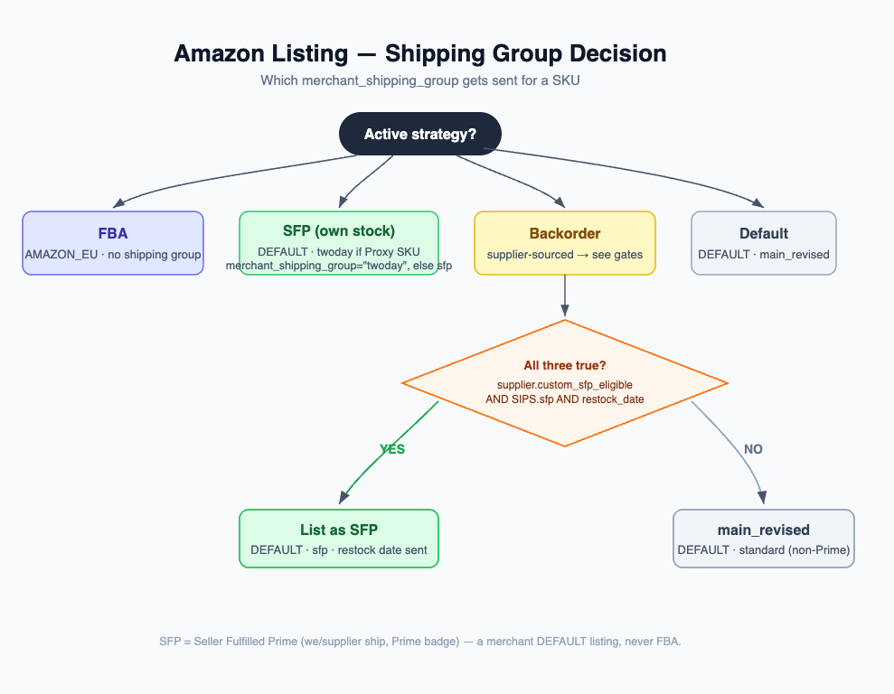

# SFP Backorder Eligibility

## What SFP means here

SFP is **Seller-Fulfilled Prime**: a Prime listing that you ship yourself from your own
stock, on the merchant `DEFAULT` channel. It is **not** FBA (where Amazon holds and ships
the stock). FBA listings carry no shipping group and are unaffected by anything on this page.

When a SKU has no warehouse stock but a supplier can replenish it, the feed lists it as a
**backorder**. A backorder normally goes out on the `main_revised` shipping group. This
feature lets a backorder instead go out on the **SFP** shipping group when the supplier is
genuinely Prime-capable for that specific item.

## The two gates

A backorder lists as SFP only when **both** eligibility gates pass:

1. **Supplier gate** — `Supplier.custom_sfp_eligible` ("Prime / SFP Eligible"). The live
   supplier-level flag, read fresh at feed-build time. Turning it off neutralizes every one
   of that supplier's items immediately, regardless of per-row flags.
2. **Per-item gate** — `Supplier Item Price and Stock.sfp` ("SFP Eligible"). A per
   supplier-item flag, so a Prime-eligible supplier can still ship specific items on
   `main_revised` instead of SFP.

A third condition is always required: a **restock date** must be available for the SKU
(from a pending purchase order, or derived from the supplier's lead time). Without a
restock date there is nothing to promise the customer, so the listing stays `main_revised`.

## Auto-propagation and manual opt-out

- **New rows inherit the supplier flag.** When a Supplier Item Price and Stock row is
  created, its `sfp` flag defaults to the parent supplier's `custom_sfp_eligible`. A new
  row under a Prime supplier starts Prime-eligible; under a non-Prime supplier it starts off.
- **Marking a supplier Prime back-fills its rows.** When `custom_sfp_eligible` flips on, all
  existing rows for that supplier are set to `sfp = 1` in one bulk update. The item gate
  therefore starts in lockstep with the supplier.
- **Per-item opt-out is sticky.** After back-fill you can untick `sfp` on individual rows to
  keep specific items on `main_revised` while the supplier stays Prime overall.
- **Turning the supplier flag off is non-destructive.** When `custom_sfp_eligible` flips off,
  per-row `sfp` flags are left untouched. They no longer have any effect because the live
  supplier gate already fails — and they are still there if the supplier is re-enabled later.

## Decision table

| Channel   | Supplier `custom_sfp_eligible` | Row `sfp` | Restock date | Shipping group  |
|-----------|--------------------------------|-----------|--------------|-----------------|
| FBA       | (any)                          | (any)     | (any)        | none            |
| Backorder | on                             | on        | yes          | **SFP**         |
| Backorder | on                             | off       | yes          | `main_revised`  |
| Backorder | off                            | on        | yes          | `main_revised`  |
| Backorder | on                             | on        | no           | `main_revised`  |

In short: a backorder lists as SFP **iff** the supplier is Prime-eligible **and** the
supplier-item row is SFP-eligible **and** a restock date exists. Otherwise it lists as
`main_revised`. FBA never carries a shipping group.

