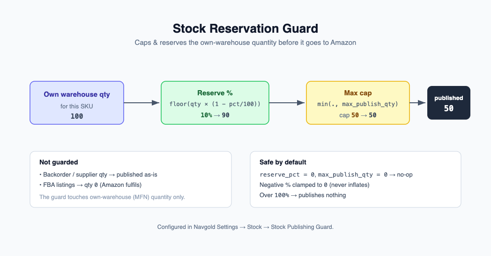

# Stock Reservation Guard

The Stock Reservation Guard caps and reserves the **own-warehouse** quantity that Navgold publishes
in the Amazon listings feed. It lets you hold back a buffer of your own stock and put a hard ceiling
on the published number, without touching backorder/supplier quantities.

It is configured globally in **Navgold Settings → Stock → Stock Publishing Guard**.



## Settings

| Field | Type | Default | Meaning |
|-------|------|---------|---------|
| Stock Reserve % | Percent | 0 | Hold back this % of own warehouse stock from the Amazon feed. |
| Max Publish Qty | Int | 0 | Ceiling on published own-stock quantity. `0` = no cap. |

## Formula

For a SKU whose own (MFN) warehouse quantity for the feed is `own_qty`:

```
published = floor(own_qty * (1 - reserve_pct / 100))
if max_publish_qty > 0:
    published = min(published, max_publish_qty)
```

The reserve is applied first (and always floors down), then the cap. With binary floating point the
floor errs toward reserving slightly more rather than less, which is the safe direction for a guard.
A negative `reserve_pct` is clamped to 0 (never inflates), and any value above 100 publishes nothing.

## Scope

- Applies to the **own warehouse quantity only**.
- **Backorder/supplier quantity is never reduced** by the guard. When a SKU is on its backorder
  strategy, the published quantity comes from supplier stock and the guard does not apply.
- FBA (Amazon-fulfilled) listings already publish quantity `0` from this code path, so they are
  unaffected.

## No-op default

With `reserve_pct = 0` and `max_publish_qty = 0` the guard is a no-op: `floor(own_qty * 1) = own_qty`
and there is no cap. Feed output is identical to having no guard configured, so the feature is
inert until you set a value.

## Worked example

Own warehouse quantity for the feed is `100`.

| Stock Reserve % | Max Publish Qty | Published own qty |
|-----------------|-----------------|-------------------|
| 0 | 0 | 100 |
| 10 | 0 | 90 |
| 0 | 50 | 50 |
| 10 | 50 | 50 |
| 25 | 0 | 75 |

(For the `10% / cap 50` row: `floor(100 * 0.9) = 90`, then `min(90, 50) = 50`.)
